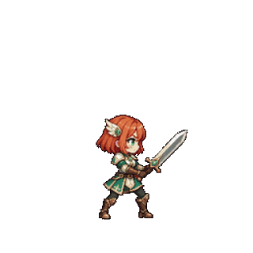
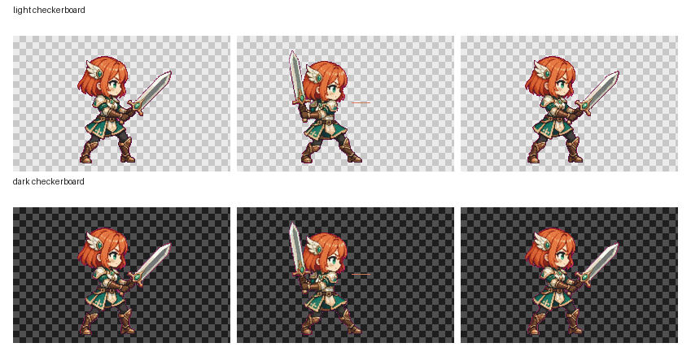
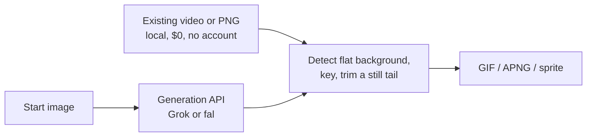
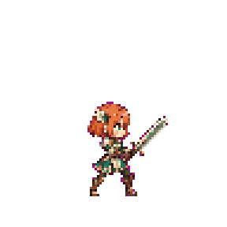
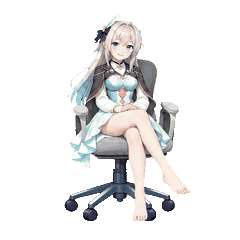
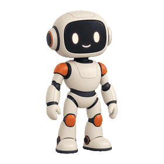
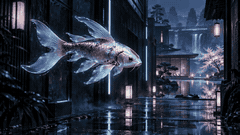
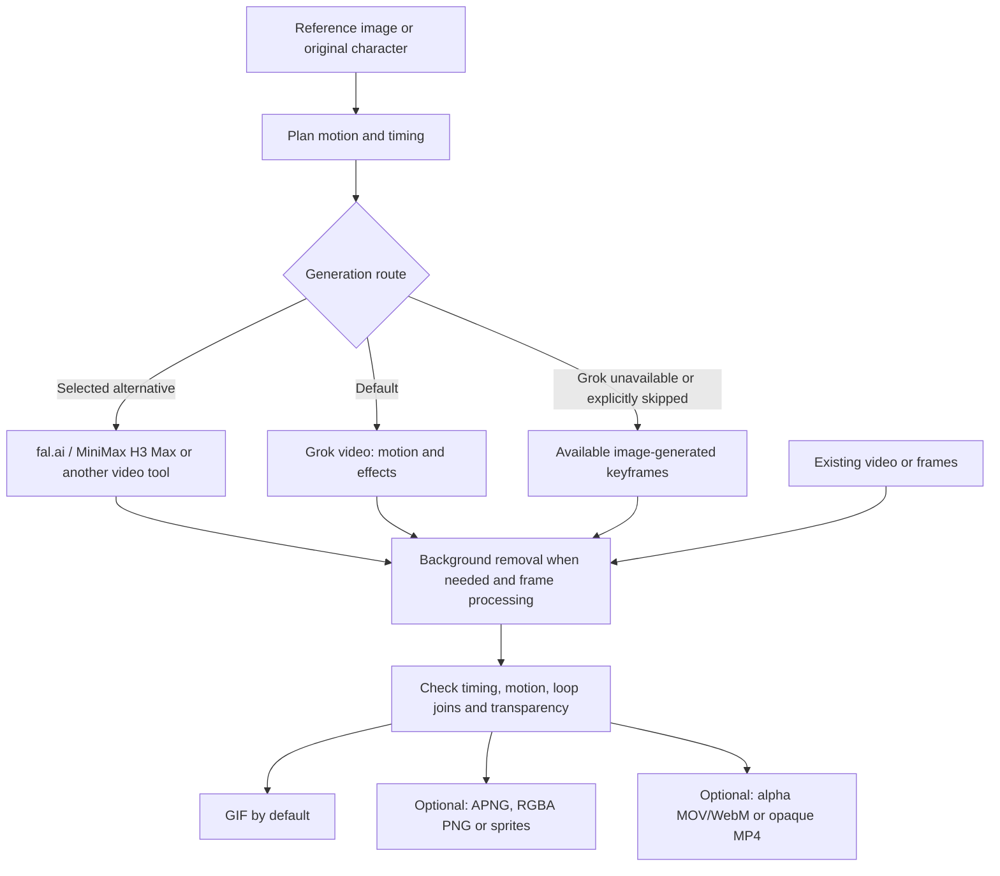

# Video GIF Studio

<p align="center">
  
</p>

[](https://github.com/miles990/video-gif-studio/actions/workflows/test.yml)
[](https://github.com/miles990/video-gif-studio/releases/latest)

**English** | [繁體中文](README.zh-TW.md) · [Preview page](docs/index.html)

Standalone CLI tool and a Codex + Claude Code skill to turn existing video (or generated clips) into transparent GIFs, APNGs, MP4s or sprite sheets.

*Transparent GIF from one local `vgs make` run ($0, auto-trimmed to 90 frames / 3.75 s so `loop` QA passes; visual review still needs a human). Tight-cropped and despilled so the first screen is the character, not padded studio space. On GitHub, the background behind the character is your page color.*

## Quick start

```sh
python scripts/install.py \
  --target claude   # or --target codex

python scripts/vgs.py make \
  <video> --out <new-dir>
```

- **Human CLI**: `python scripts/vgs.py make <video> --out <new-dir>` (run from the installed skill dir with its `.venv/bin/python`). Auto-keys saturated flat studio backdrops (`magenta`/`green`); `--no-key` keeps them and fails transparent delivery.
- **Agent skill**: Claude Code `/video-gif-studio` · Codex `$video-gif-studio`. If your environment has no built-in image tool, supply a start image or existing video ($0 locally).



## A local run (QA pops warning, loop PASS)

Actual output of `python scripts/vgs.py make examples/chibi-running-dash/source.mp4 --out /tmp/chibi-gif` (2026-11-22, no generation API):

```text
已去背，鍵色 #FC01F9（容差 0.2，柔化 0.18，信心 1.000）。
警告：內部鍵色區最大比例 0.0465，第 54 幀；如需保留請加 --keep-interior-key。
border_opaque_max 0.0000；key_share_max 0.0000（第 0 幀）。
尺寸 320×320；90 幀，3.75 秒，0.70 MB。（預設寬度 320）
尾端 trim：原長 6.04s，新長 3.75s；來源 3.75 到 6.04s 已裁切，保留約 0.29s guard；最後移動幀 3.42s。
QA WARN；pops WARN: Small transient pop scan; inspect in context
loop 量測通過（未經視覺核准）；輸出 /tmp/chibi-gif/animation.gif
視覺核准：未評估，需人看。
```

*English summary of the stdout above: background keyed (`#FC01F9`, confidence `1.000`, `border_opaque_max 0`, `key_share_max 0`); warns about a `4.65%` enclosed key pocket at frame 54 (`--keep-interior-key` preserves it); `320×320`, `90` frames, `3.75 s`, `0.70 MB`; QA `WARN` (`pops` only) and `loop` measurement `PASS` (visual approval still pending).*

If `--out` already has files, it writes nothing and explains the fix:

```text
輸出目錄 /tmp/vgs-occupied 非空；不會寫入或刪除檔案。請改用一個新的空目錄，例如 --out /tmp/vgs-new-output。
```

## How it works



Local steps (doctor, chroma key, encode, QA, import of a video you already have) stay on the machine. Grok and fal are optional generation steps and need their own account or credits.

### Image-to-video options

Prices checked 2026-11-22. **Recheck before listing.**

| Route | Price |
| --- | --- |
| Local existing media | $0 |
| Grok / X plan website | Uses the site’s weekly shared credit pool (not a retail per-second price) |
| Grok API (prepaid credits, not the weekly pool) | Grok 1.5 $0.080/sec, lite $0.020/sec. A resolution-tier table may differ; recheck before listing. |
| fal MiniMax H3 Max, from 2026-11-16 | $0.05 / $0.08 / $0.16 per second at 480p / 768p / 1080p |

Installer: `--skills-dir` overrides everything; `--target claude` installs to `~/.claude/skills`; `--target codex` installs to `$CODEX_HOME/skills` or `~/.codex/skills`. With no flags: `CODEX_HOME` if set, else an existing `~/.codex`, else an existing `~/.claude`, else `~/.codex`. `--skip-deps` only registers the skill and does not mean the runtime is ready.


### Pixel export

```sh
python scripts/vgs.py make examples/chibi-running-dash/source.mp4 --pixel --sprite --mp4 --out /tmp/chibi-pixel
```

<p align="center"></p>

`--pixel` uses a 96-pixel grid, 32 colors and integer nearest-neighbor scaling. Set `--pixel-width`, `--pixel-scale` and `--colors` to customize it. `--sprite` exports frames and sheets at GIF output size; engine validation is not performed. `--mp4` composites onto #141820 and repeats complete loops; use `--loop-count` to set repetitions. The default aims for 8–15 seconds when possible. `--loop auto` searches a natural trim; `--loop crossfade` explicitly blends the end; `--loop off` uses ordinary tail trimming. Auto-key requires a flat border and saturation `(max-min)/max >= 0.35`; low-saturation neutral backgrounds stay opaque so skin and white highlights are not erased (only force `--key HEX` when the foreground has no overlapping neutral tones, or use optional `scripts/background_remove.py` / a saturated backdrop). Global keying can remove enclosed key-colored artwork; the warning identifies it, and `--keep-interior-key` preserves it. `vgs qa` checks both border opacity and remaining key colors. Visual approval remains necessary.

## Measured delivery QA

```sh
python scripts/qa_media.py examples/chibi-running-dash/final.gif --out qa/chibi
python scripts/qa_media.py examples/neon-zen-pv/final.mp4 --out qa/neon --timeline examples/neon-zen-pv/timeline.json
```

One command writes `report.md`, `report.json`, `contact_sheet.jpg`, a 360 px wide `phone_sheet.jpg`, and `hook_sheet.jpg` for the first three seconds. Use a new output directory. GIF/APNG/numbered RGBA PNG folders need NumPy and Pillow; MP4/audio use the existing FFmpeg/ffprobe runtime (`VIDEO_GIF_FFMPEG`, `VIDEO_GIF_FFPROBE`, or `python scripts/media_runtime.py --install`). QA never downloads dependencies.

PASS confirms measured thresholds; WARN needs inspection at the listed frame/second; FAIL blocks delivery (exit 1; input/runtime errors exit 2). Reports cannot certify natural motion or meaning. Use `--fps 25` for PNG frames, `--loop` for loops (automatic for infinite-loop GIF/APNG), `--holds 1.0-3.0` for designed pauses, and `--expect-cuts 2.0,4.0` for hard cuts. Ordinary timeline joins are not required hard cuts. Silent assets report audio N/A. See [quality review](references/quality-review.md) for limits and independent review.

Adapted from [win4r/video-director](https://github.com/win4r/video-director), MIT, © 2026 win4r. [THIRD_PARTY.md](THIRD_PARTY.md) includes the full MIT license.

## Examples

**Seated leg switch** — Reference image → Grok video → transparent GIF.



[GIF](examples/seated-leg-switch/final.gif) · [Reference, prompt and production record](examples/seated-leg-switch/README.md)

**Original robot wave** — Created without a reference image.



[GIF](examples/robot-wave-no-reference/final.gif) · [Production record](examples/robot-wave-no-reference/README.md)

**Chibi dash attack** — Running steps, sword trails and recovery. Full-speed loop review remains pending.

<p align="center"></p>

[GIF](examples/chibi-running-dash/final.gif) · [APNG](examples/chibi-running-dash/final.apng) · [Sprite pack](examples/chibi-running-dash/sprites.zip) · [Production record](examples/chibi-running-dash/README.md)

**NEON ZEN** — 30-second music PV assembled from five Grok clips. Full-speed music sync review remains pending.



[MP4 with music](examples/neon-zen-pv/final.mp4) · [Story and production record](examples/neon-zen-pv/README.md)

## Purpose

A **standalone CLI and a Codex + Claude Code skill** for AI animation, transparent GIF creation, game sprite sheets and video editing, with script/storyboard planning and music beat analysis.

**Turn a simple description into the animation or related assets you want.** Provide text, reference images, video or music, and let the skill plan the script, motion, effects, editing and export—or handle just one step. Create GIFs, videos, APNGs and game sprites with less manual coordination. Complex results may still need review and refinement.

## Main workflow



Codex coordinates the workflow. Available image tools create characters or explicitly requested repairs; use GPT-Image-2.5 when exposed by the environment. **Grok is the default for new motion and unspecified effects.** Preserve source frames, plausible anatomy, weight transfer and complete effect framing.

**Other generative video tools can replace Grok:** use an available tool or import its generated video into the same processing workflow. **Grok and fal.ai MiniMax H3 Max are built in.** Select H3 Max for fast iteration, first/last-frame control or multimodal references; other services require their own access or integration. [fal setup](references/fal.md). Image-generated keyframes and existing media are also options. See [fallback options](references/fallback.md).

**Why Grok:** Grok is the default to achieve natural animation with strong motion continuity. Codex then processes the frames, checks the result and exports it. Results still need review; GIF generation also works without Grok.

## Installation

The AI checks and downloads missing tools, including Python, required packages, FFmpeg/ffprobe and the Grok CLI for OAuth, then verifies readiness. You complete any required Grok login authorization.

Give this request to your AI assistant:

> Install video-gif-studio from https://github.com/miles990/video-gif-studio. Follow references/install.md, preserve existing data, install dependencies and run the doctor check. Report local tools and Grok readiness separately. For Claude Code, run `python scripts/install.py --target claude` (or set `--skills-dir`). For Codex, use `--target codex` or the default path.

See [installation instructions](references/install.md). Then invoke `/video-gif-studio` in Claude Code or `$video-gif-studio` in Codex.

## Requirements

- **Codex** or **Claude Code**, plus an available image-generation tool when creating character images or keyframes. If no built-in image tool is available, supply a start image or an existing video.
- **Grok** — default but optional. Sign in to [Grok Imagine](https://grok.com/imagine) to generate video on the website, then import the downloaded video; no API key or CLI is needed for website use. Account access and limits apply. The bundled automatic client uses separate CLI OAuth or API-key authentication. [Connection setup](references/grok.md).
- **fal.ai / MiniMax H3 Max** — optional built-in alternative; requires `FAL_KEY` and available account credit. No Grok login or external project required. [Connection and limits](references/fal.md).
- **Python 3.11+** — the installer manages Python packages and missing FFmpeg/ffprobe on supported platforms. [Dependencies](references/dependencies.md).

## Usage

Describe what you want; let the skill choose the script, motion, duration, camera, effects and export settings based on your intended use. Defaults are Grok generation and GIF output. It asks only for essential missing information or additional spending authorization.

> Use $video-gif-studio to create a character animation. Decide the script, motion, duration, camera, effects and output format for me.

> Use $video-gif-studio to create a transparent character GIF from this image, with natural motion and a seamless loop.

> Use $video-gif-studio to create an original chibi swordswoman performing a dash attack with elaborate sword effects. Export APNG and a sprite sheet.

| Option | Choices |
| --- | --- |
| Video source | Grok (default), built-in fal.ai / MiniMax H3 Max, or another available provider |
| Input | Reference image, original character, existing video or frames |
| Background | Auto (default), preserve artwork, explicitly requested AI repair |
| Output | **GIF (default)**, APNG, PNG frames, sprite sheets, MOV, WebM, MP4 |
| Editing | Trim, reorder, retime, timed stills, timed loops, music and beat alignment |
| Continuation | Selected keyframes, last frame + consistency references, or last frame only; subject to provider support |

**GIF has binary transparency.** Use RGBA PNG/APNG for soft edges and fading effects, or alpha-capable MOV/WebM. **MP4 is opaque.** Game assets favor PNG frames and sprite sheets; pixel art preserves its logical grid and nearest-neighbor scaling.

### Reusable agent characters

Generate actions once, then reuse transparent sprites through entry, loop and exit states. Shared poses, pivots and reviewed transitions help natural continuity; state machines do not automatically repair motion. [Action-library guidance](references/animation-states.md).

> Use $video-gif-studio with fal.ai MiniMax H3 Max to create a transparent full-body agent character, with reusable idle and greeting animations.

### Script and storyboard planning

Provide a theme or mood and let the skill plan the story, shots, durations, camera angles, character actions, effects, transitions and generation prompts. Music accents can be planned when relevant; precise beat timing needs the audio. **You can request only a script and storyboard, without generating video.**

> Use $video-gif-studio to plan a 30-second anime PV about saying goodbye and starting again. Decide the creative details; output only the script and storyboard.

### Find animation cues in music

Provide an audio file to estimate BPM, detect beat and onset candidates, and list timestamps with suggested uses for cuts, attacks, transitions or effect bursts. **You can request music analysis only, without generating video.** Automatic cues need listening review; sync the actual action event, not just the clip boundary.

> Use $video-gif-studio to analyze this music, find suitable animation cue points, and list timestamps with suggested uses. Do not generate video yet.

See [music analysis and beat alignment](references/music.md).

### Simple video editing

Trim, split and reorder clips, adjust speed or duration, join segments, insert stills, repeat loops for a set time, and add music with beat-aligned editing. **These edits run locally without Grok or new video generation.** Codex operates the tools; there is no graphical editor, and music sync needs playback review.

> Use $video-gif-studio to trim these videos, arrange the clips, hold the last frame for 2 seconds, add this music and export an MP4. Decide the pacing for me.

See [timeline editing](references/timeline.md) and [music and beat alignment](references/music.md).

### Special use: continuously extend a video

**In principle, repeated generation and stitching can keep extending a video without a fixed total-duration ceiling.** Use the last frame and suitable consistency references to generate the next segment, review the join, then append and repeat. This uses multiple generation requests, not one unlimited-length request.

Each task needs a target duration, segment count or budget. Actual length is constrained by quota, cost, compute/storage and accumulated continuity drift. Codex coordinates the process; automatic chain execution and edit/extend CLI modes are not bundled. The fal client supports multi-reference generation. See [continuation workflow](references/chain.md).

Details: [Skill](SKILL.md) · [Transparency](references/transparency.md) · [Pixel art](references/pixel-art.md) · [Sprites](references/sprites.md) · [Video export](references/video-export.md) · [Timeline](references/timeline.md) · [Music](references/music.md) · [Continuation](references/chain.md)

License: [MIT](LICENSE)

## Character video editing and original-audio delivery

Use the [character replacement workflow](references/character-video-edit.md) and `scripts/assemble_edit.py` for frame-based assembly, explicit FPS conform, time-bounded source-region restoration, and complete original-audio stream verification. This local tool does not guarantee generated identity or choreography; its report keeps visual review pending.

## Beat-synchronized post-production FX / ??????

Explicitly requested effects use `python scripts/fx_render.py plan.json --out delivery --formats gif mp4`: six pure effects, four transitions, beat/onset/energy envelopes, a reusable local library, and reference breakdown drafts. Effects never replace physical motion. See [FX guide](references/fx.md), [demo and measurements](wow/fx/demo/README.md), and [build status](wow/fx/build-notes.md).
