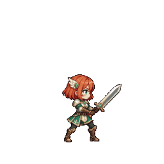
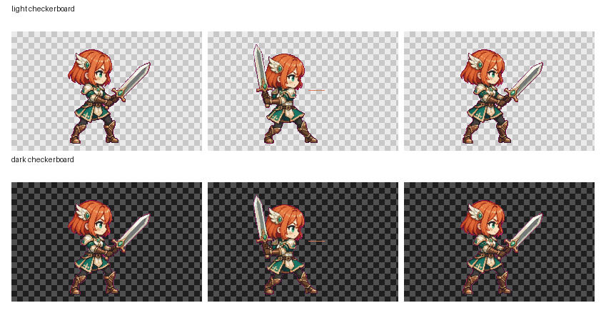
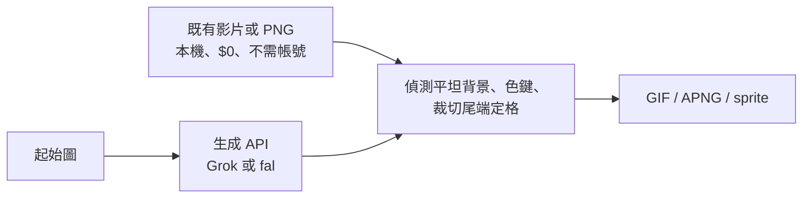
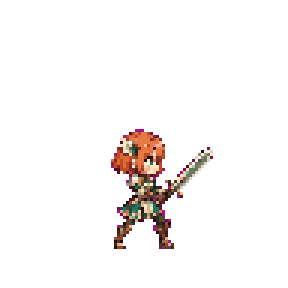
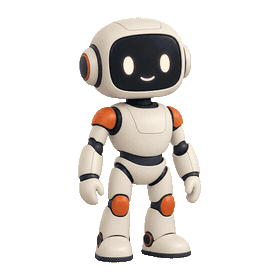
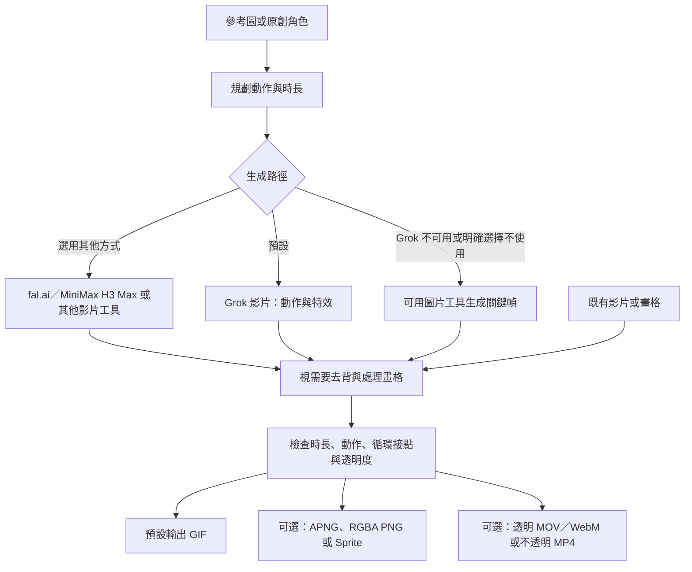

# Video GIF Studio

<p align="center">
  
</p>

[](https://github.com/miles990/video-gif-studio/actions/workflows/test.yml)
[](https://github.com/miles990/video-gif-studio/releases/latest)

[English](README.md) | **繁體中文** · [預覽頁](docs/index.html)

這是獨立 CLI 工具，同時也是 Codex 與 Claude Code skill，把既有影片（或生成片段）做成透明 GIF、APNG、MP4 或 sprite sheet。

*本機單條 `vgs make` 產出的透明 GIF（$0，已自動裁切至 90 幀／3.75 秒使 `loop` 量測通過；視覺無縫仍須人看）。已緊裁並去除洋紅溢色，第一屏是角色本身，不是大片留白。你在 GitHub 看到的底色是頁面顏色，不是棚景。*

## 快速開始

```sh
python scripts/install.py \
  --target claude   # 或 --target codex

python scripts/vgs.py make \
  <video> --out <new-dir>
```

- **人用 CLI**：`python scripts/vgs.py make <video> --out <new-dir>`（在已安裝的 skill 目錄以 `.venv/bin/python` 執行）。高飽和平坦棚景（洋紅／綠幕）會自動色鍵；`--no-key` 保留背景並讓透明交付失敗。
- **Agent skill**：Claude Code `/video-gif-studio` · Codex `$video-gif-studio`。若環境沒有內建生圖，請提供起始圖或既有影片（本機路徑 $0）。



## 執行後會長這樣（含 pops WARN，loop 通過）

本機實際執行 `python scripts/vgs.py make examples/chibi-running-dash/source.mp4 --out /tmp/chibi-gif`（2026-11-22，未呼叫生成 API）：

```text
已去背，鍵色 #FC01F9（容差 0.2，柔化 0.18，信心 1.000）。
警告：內部鍵色區最大比例 0.0465，第 54 幀；如需保留請加 --keep-interior-key。
border_opaque_max 0.0000；key_share_max 0.0000（第 0 幀）。
尺寸 320×320；90 幀，3.75 秒，0.70 MB。（預設寬度 320）
尾端 trim：原長 6.04s，新長 3.75s；來源 3.75 到 6.04s 已裁切，保留約 0.29s guard；最後移動幀 3.42s。
QA WARN；pops WARN: Small transient pop scan; inspect in context
loop 量測通過（未經視覺核准）；輸出 /tmp/chibi-gif/animation.gif
視覺核准：未評估，需人看。
```

若 `--out` 目錄已有檔案，指令不會寫入任何東西，並說明下一步：

```text
輸出目錄 /tmp/vgs-occupied 非空；不會寫入或刪除檔案。請改用一個新的空目錄，例如 --out /tmp/vgs-new-output。
```

## 運作方式



本機步驟（doctor、色鍵、編碼、QA、匯入你已有的影片）都在這台電腦完成。Grok 與 fal 是可選的生成步驟，需要各自的帳號或額度。

### 圖生影選項

價格核對日期 2026-11-22。**上架前再查。**

| 路徑 | 價格 |
| --- | --- |
| 本機既有媒體 | $0 |
| Grok／X 方案網站 | 使用網站的每週共享額度（不是零售每秒單價） |
| Grok API（預付點數，不是每週額度池） | Grok 1.5 為 $0.080／秒、lite 為 $0.020／秒。分級表可能不同；上架前再查。 |
| fal MiniMax H3 Max，自 2026-11-16 起 | 480p／768p／1080p 分別為每秒 $0.05／$0.08／$0.16 |

安裝器：`--skills-dir` 會覆蓋其他選擇；`--target claude` 裝到 `~/.claude/skills`；`--target codex` 裝到 `$CODEX_HOME/skills` 或 `~/.codex/skills`。未加旗標時：若已設 `CODEX_HOME` 就用它，否則既有的 `~/.codex`，再否則既有的 `~/.claude`，最後才是 `~/.codex`。`--skip-deps` 只做註冊，不代表執行環境已備妥。


### 像素輸出

```sh
python scripts/vgs.py make examples/chibi-running-dash/source.mp4 --pixel --sprite --mp4 --out /tmp/chibi-pixel
```

<p align="center"></p>

`--pixel` 預設 96 像素網格、32 色與整數最近鄰放大，可用 `--pixel-width`、`--pixel-scale`、`--colors` 調整。`--sprite` 以 GIF 輸出尺寸匯出影格和圖集，未做引擎驗證；`--mp4` 合成深色底並重複完整循環，`--loop-count` 指定次數，預設盡可能落在 8–15 秒。`--loop auto` 尋找自然裁切點，`--loop crossfade` 明確混合尾端，`--loop off` 只裁靜止尾端。自動去背需要平坦邊框且飽和度 `(max-min)/max >= 0.35`；低飽和背景會保留不透明以免誤傷膚色與白衣高光（僅在主體不含近白／膚色時才強制 `--key HEX`，或改用可選去背 `scripts/background_remove.py`／高飽和棚景）。全域色鍵可能挖掉封閉的同色圖案；警告列出內島，`--keep-interior-key` 可保留。`vgs qa` 檢查邊框不透明度與殘留鍵色；仍需人看核准。

## 交付品質量測

```sh
python scripts/qa_media.py examples/chibi-running-dash/final.gif --out qa/chibi
python scripts/qa_media.py examples/neon-zen-pv/final.mp4 --out qa/neon --timeline examples/neon-zen-pv/timeline.json
```

單一指令產生 `report.md`、`report.json`、`contact_sheet.jpg`、寬度 360 px 的 `phone_sheet.jpg`，以及前三秒的 `hook_sheet.jpg`。每次使用新輸出目錄。GIF/APNG／數字命名 RGBA PNG 資料夾只需 NumPy、Pillow；MP4／音訊使用既有 FFmpeg/ffprobe runtime（`VIDEO_GIF_FFMPEG`、`VIDEO_GIF_FFPROBE` 或 `python scripts/media_runtime.py --install`）。QA 不會自動下載依賴。

PASS 表示量測門檻通過；WARN 要依格號／秒數檢視；FAIL 阻擋交付（結束碼 1；輸入／環境錯誤為 2）。數字不能證明動作自然或語意正確。PNG 用 `--fps 25`，循環用 `--loop`（無限循環 GIF/APNG 自動檢查），設計停格用 `--holds 1.0-3.0`，硬切用 `--expect-cuts 2.0,4.0`。一般時間軸接續點不強制要求硬切；無音軌標示 N/A。詳見[品質審查](references/quality-review.md)的量測限制與獨立評審流程。

改寫自 [win4r/video-director](https://github.com/win4r/video-director)，MIT，© 2026 win4r。[THIRD_PARTY.md](THIRD_PARTY.md) 保留完整 MIT 授權。

## 範例

**坐姿換腿** — 參考圖 → Grok 影片 → 透明 GIF。


[GIF](examples/seated-leg-switch/final.gif) · [參考圖、提示詞與製作紀錄](examples/seated-leg-switch/README.zh-TW.md)

**原創機器人揮手** — 不使用參考圖，從文字建立角色。



[GIF](examples/robot-wave-no-reference/final.gif) · [製作紀錄](examples/robot-wave-no-reference/README.zh-TW.md)

**Q 版前衝攻擊** — 小跑步、劍光與收招；正常速度下的循環驗收仍待完成。

<p align="center"></p>

[GIF](examples/chibi-running-dash/final.gif) · [APNG](examples/chibi-running-dash/final.apng) · [Sprite 素材包](examples/chibi-running-dash/sprites.zip) · [製作紀錄](examples/chibi-running-dash/README.zh-TW.md)

**NEON ZEN** — 五段 Grok 影片串接成 30 秒音樂 PV；完整播放的音樂同步驗收仍待完成。


[有聲 MP4](examples/neon-zen-pv/final.mp4) · [腳本與製作紀錄](examples/neon-zen-pv/README.zh-TW.md)

## 目的

這是 **獨立 CLI，同時也是 Codex 與 Claude Code skill**，用於 AI 動畫、透明 GIF、遊戲 Sprite Sheet 與影片剪輯，也支援腳本／分鏡規劃及音樂卡點分析。

**用簡單描述，方便地製作想要的動畫與相關素材。** 提供文字、參考圖、影片或音樂，讓 skill 規劃腳本、動作、特效、剪輯與輸出，也能只做其中一步。減少手動串接工具的工作，製作 GIF、影片、APNG 與遊戲用 Sprite；複雜成果仍可能需要檢查與調整。

## 主要工作流



由 Codex 協調整體流程；可用圖片工具負責建立角色或明確要求的修復，環境提供 GPT-Image-2.5 時可使用。**新動作預設使用 Grok，未指定的特效也交由 Grok 生成。** 保留來源畫格、合理人體結構與重心轉移，特效完整入鏡。

**也可使用其他生成式影片工具替代 Grok：**使用可用工具生成，或匯入其產出的影片，接續相同的處理流程。**Repo 內建 Grok 與 fal.ai／MiniMax H3 Max 連線。** H3 Max 適合快速試作，支援首尾幀與多素材參考；其他服務需另有使用權限或整合方式。[fal 設定](references/fal.md)；也可使用圖片關鍵幀與既有素材。詳見[替代流程](references/fallback.md)。

**為什麼使用 Grok：**預設使用 Grok，是為了得到自然、連續性好的動畫效果，再由 Codex 處理畫格、檢查與輸出。實際效果仍須驗收；沒有 Grok 也可以生成 GIF。

## 安裝方法

AI 會檢查並自行下載安裝缺少的 Python、必要套件、FFmpeg／ffprobe 與 OAuth 所需的 Grok CLI，再驗證是否就緒；需要 Grok 登入時，由你完成帳號授權。

把這段交給 AI 助理：

> 請安裝 https://github.com/miles990/video-gif-studio。依 references/install.md 操作，保留既有資料，安裝依賴並執行 doctor 驗證，分別回報本機工具與 Grok 是否就緒。Claude Code 請執行 `python scripts/install.py --target claude`（或指定 `--skills-dir`）；Codex 請用 `--target codex` 或預設路徑。

詳見[安裝說明](references/install.md)。然後在 Claude Code 呼叫 `/video-gif-studio`，或在 Codex 呼叫 `$video-gif-studio`。

## 需求

- **Codex** 或 **Claude Code**；建立角色圖或關鍵幀時，另需可用圖片生成工具。若環境沒有內建生圖，請提供起始圖或既有影片。
- **Grok** — 預設使用，但非必要依賴。登入 [Grok Imagine 網站](https://grok.com/imagine) 即可使用網站影片生成功能，再匯入下載的影片，不必設定 API key 或 CLI；依帳號權限與額度使用。Repo 的自動連線工具則另用 CLI OAuth 或 API key 登入。[連線設定](references/grok.md)。
- **fal.ai／MiniMax H3 Max** — 可選的內建替代來源，需設定 `FAL_KEY` 並有可用額度；不依賴 Grok 登入或其他專案。[連線與限制](references/fal.md)。
- **Python 3.11+** — 安裝器管理 Python 套件，並在支援平台下載缺少的 FFmpeg／ffprobe。[依賴說明](references/dependencies.md)。

## 使用方法

只要簡單描述想做什麼，其餘可交給 skill 依用途決定：腳本、動作、時長、鏡頭、特效與輸出設定。預設使用 Grok、輸出 GIF；只有缺少必要資訊或涉及額外付費授權時才詢問。

> 使用 $video-gif-studio 製作一段角色動畫，腳本、動作、時長、鏡頭、特效與輸出方式都由你決定。

> 使用 $video-gif-studio，參考這張角色圖，製作動作自然、無縫循環的透明 GIF。

> 使用 $video-gif-studio，建立原創 Q 版女劍士，做帶有華麗劍光的前衝攻擊，輸出 APNG 與 Sprite Sheet。

| 選項 | 可選內容 |
| --- | --- |
| 影片來源 | Grok（預設）、內建 fal.ai／MiniMax H3 Max，或其他可用服務 |
| 輸入 | 參考圖、原創角色、既有影片或畫格 |
| 背景處理 | 自動（預設）、保留原畫、明確選擇 AI 修復 |
| 輸出 | **GIF（預設）**、APNG、PNG 畫格、Sprite Sheet、MOV、WebM、MP4 |
| 剪輯 | 裁切、排序、變速、定時靜止、定時循環、音樂與卡點 |
| 接續 | 合適關鍵幀、尾幀＋一致性參考圖、只有尾幀；依模型支援選用 |

**GIF 只能全透明或全不透明。** 柔邊與消散特效使用 RGBA PNG／APNG，或支援 Alpha 的 MOV／WebM；**MP4 不保留透明度**。遊戲素材優先使用 PNG 畫格與圖集；像素風保留原生像素格，採最近鄰縮放。

### 可重用的 Agent 角色

動作生成一次後，以透明 Sprite 重複使用，規劃進入、循環和退出狀態。共同姿勢、固定基準點與接縫驗收有助自然銜接；狀態機不會自動修復動作。[動作庫說明](references/animation-states.md)。

> 使用 $video-gif-studio，透過 fal.ai MiniMax H3 Max 製作透明背景的全身 Agent 角色，包含可重用的待機與致意動畫。

### 腳本與分鏡規劃

提供主題或想傳達的感覺，即可讓 skill 規劃故事、分鏡、各鏡頭時長、視角、角色動作、特效、轉場與生成提示詞。有需要時也能規劃音樂卡點；精確對拍需提供音訊。**可只產出腳本與分鏡，不生成影片。**

> 使用 $video-gif-studio，設計一支 30 秒日系動畫 PV。主題是告別與重新出發，其他由你決定，只輸出腳本與分鏡。

### 提供音樂找卡點

提供音訊，即可估計 BPM、分析拍點與明顯的能量突起，列出時間戳，並建議適合剪接、出招、轉場或特效爆發的位置。**可只分析卡點，不生成影片。** 自動結果是候選位置，仍需聆聽確認；實際剪輯須對齊動作發生的瞬間，不只對齊片段邊界。

> 使用 $video-gif-studio 分析這首音樂，找出適合動畫卡點的位置，列出時間戳與建議用途，先不要生成影片。

詳見[音樂分析與卡點](references/music.md)。

### 簡單影片剪輯

支援裁切、拆段與排序、變速或調整時長、串接片段、插入靜止畫面、定時循環，以及配樂與卡點剪輯。**這些操作在本機完成，不需要 Grok 或重新生成影片。** 由 Codex 操作工具，沒有圖形化剪輯介面；音樂同步仍須播放檢查。

> 使用 $video-gif-studio，裁切並安排這些影片，讓尾幀停留 2 秒，加上這首音樂，輸出 MP4。剪輯節奏由你決定。

詳見[時間軸剪輯](references/timeline.md)與[音樂及卡點](references/music.md)。

### 特殊用法：持續延長影片

**理論上可透過反覆生成與串接，持續延長影片，沒有固定的總時長上限。** 使用尾幀與合適的一致性參考圖生成下一段，檢查接點後接上，再重複此流程；這是多次生成，不是單次請求產出無限長影片。

每次任務仍須設定目標時長、段數或預算；實際受額度、成本、運算／儲存資源與累積的畫面一致性偏差限制。流程由 Codex 協調，自動 chain 執行器與影片編輯／延伸 CLI 模式尚未內建；fal 命令已支援多素材參考生成。詳見[接續流程](references/chain.md)。

詳細說明：[Skill](SKILL.md) · [透明處理](references/transparency.md) · [像素風](references/pixel-art.md) · [Sprite](references/sprites.md) · [影片輸出](references/video-export.md) · [時間軸](references/timeline.md) · [音樂](references/music.md) · [接續生成](references/chain.md)

授權：[MIT](LICENSE)

## 換角影片與原聲交付

參閱[換角製作與驗收](references/character-video-edit.md)。`scripts/assemble_edit.py` 提供按幀組裝、缺幀拒絕、限定時間的原片區域還原，以及分離混流後的完整原聲雜湊驗證；生成的人物、動作與運鏡仍須人工逐段驗收。

## Beat-synchronized post-production FX / ??????

Explicitly requested effects use `python scripts/fx_render.py plan.json --out delivery --formats gif mp4`: six pure effects, four transitions, beat/onset/energy envelopes, a reusable local library, and reference breakdown drafts. Effects never replace physical motion. See [FX guide](references/fx.md), [demo and measurements](wow/fx/demo/README.md), and [build status](wow/fx/build-notes.md).
