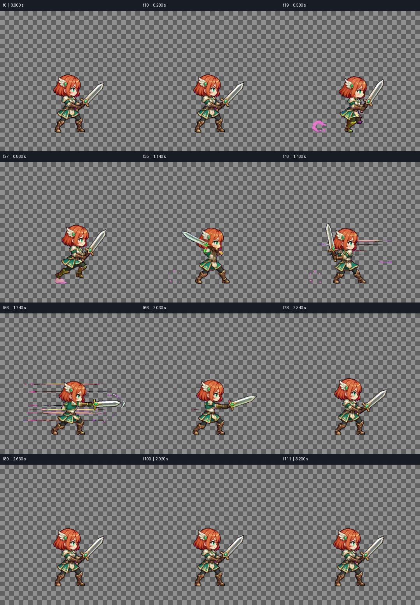
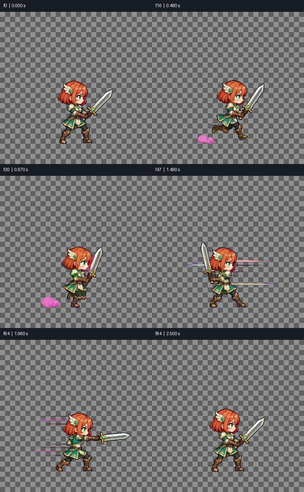

# Media QA: WARN

final.apng | 112 frames | 3.230 s

Numeric screening is not proof of natural motion, correct semantics, good matting or audio/video sync. Review playback independently.

## PASS — frame0

Visible composition has exposure and contrast
- f0 / 0.000 s

```json
{
  "mean": 105.94625854492188,
  "contrast": 58.84313201904297
}
```

## PASS — flashes

Single-frame flash scan

## WARN — pops

Small transient pop scan; inspect in context
- f38 / 1.240 s
- f53 / 1.660 s
- f54 / 1.680 s

## PASS — freeze

Frozen stretches; mark intended pauses with --holds START-END or timeline still segments

```json
{
  "designed_holds": []
}
```

## PASS — cuts

Detected cut candidates (no hard cuts required)

```json
{
  "detected": [],
  "expected_seconds": []
}
```

## PASS — timeline_joins

Continuation/edit boundaries are not required hard cuts; review continuity

## PASS — loop

Loop position and speed
- f111 / 3.230 s -> f0

```json
{
  "seam": 0.2926793396472931,
  "median_step": 0.9927388429641724,
  "seam_ratio": 0.2948200745055926,
  "speed_ratio": 0.48923815499333906,
  "position_pass": true,
  "speed_pass": true,
  "speed_applicable": false
}
```

## N/A — loudness

N/A: no audio track

```json
{
  "applicable": false
}
```

## N/A — true_peak

N/A: no audio track

```json
{
  "applicable": false
}
```

## N/A — loudest_100ms

N/A: no audio track

```json
{
  "applicable": false
}
```

## N/A — silence

N/A: no audio track

```json
{
  "applicable": false
}
```





Analysis and sheets: 2.120 s.
