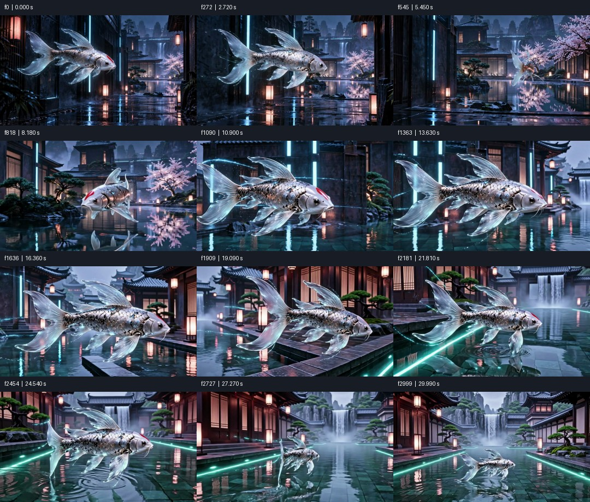
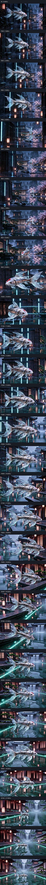
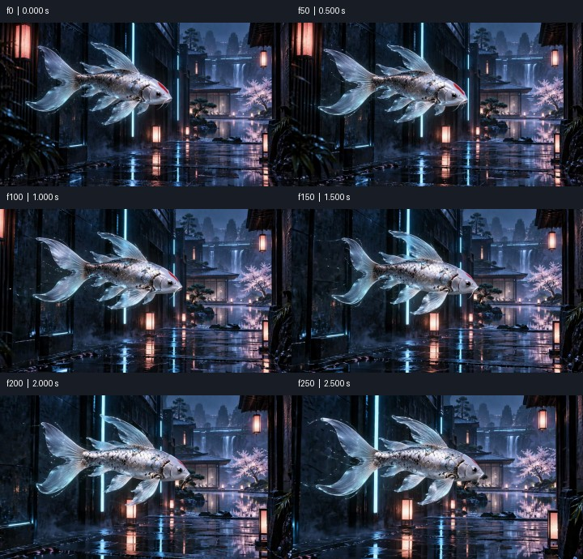

# Media QA: PASS

final.mp4 | 3000 frames | 30.000 s

Numeric screening is not proof of natural motion, correct semantics, good matting or audio/video sync. Review playback independently.

## PASS — frame0

Visible composition has exposure and contrast
- f0 / 0.000 s

```json
{
  "mean": 51.62196350097656,
  "contrast": 47.09947204589844
}
```

## PASS — flashes

Single-frame flash scan

## PASS — pops

Small transient pop scan; inspect in context

## PASS — freeze

Frozen stretches; mark intended pauses with --holds START-END or timeline still segments

```json
{
  "designed_holds": []
}
```

## PASS — cuts

Detected cut candidates (no hard cuts required)

```json
{
  "detected": [],
  "expected_seconds": []
}
```

## PASS — timeline_joins

Continuation/edit boundaries are not required hard cuts; review continuity
- f350 / 3.500 s
- f555 / 5.550 s
- f1173 / 11.730 s
- f1760 / 17.600 s
- f2127 / 21.270 s
- f2420 / 24.200 s

## PASS — loop

N/A: no loop requested

## PASS — loudness

Integrated loudness: target -14 LUFS +/-1
- f0 / 0.000 s to f2999 / 30.000 s (time end exclusive)

```json
{
  "lufs": -14.1
}
```

## PASS — true_peak

True peak ceiling -1 dBTP
- f0 / 0.000 s to f2999 / 30.000 s (time end exclusive)

```json
{
  "dbtp": -2.3
}
```

## PASS — loudest_100ms

Loudest 100 ms RMS window (50 ms hop)
- f240 / 2.400 s to f250 / 2.500 s (time end exclusive)

```json
{
  "dbfs": -9.84833358509824
}
```

## PASS — silence

Silence >=0.4 s; inspect whether intended

```json
{
  "threshold_dbfs": -40
}
```





Analysis and sheets: 10.095 s.
