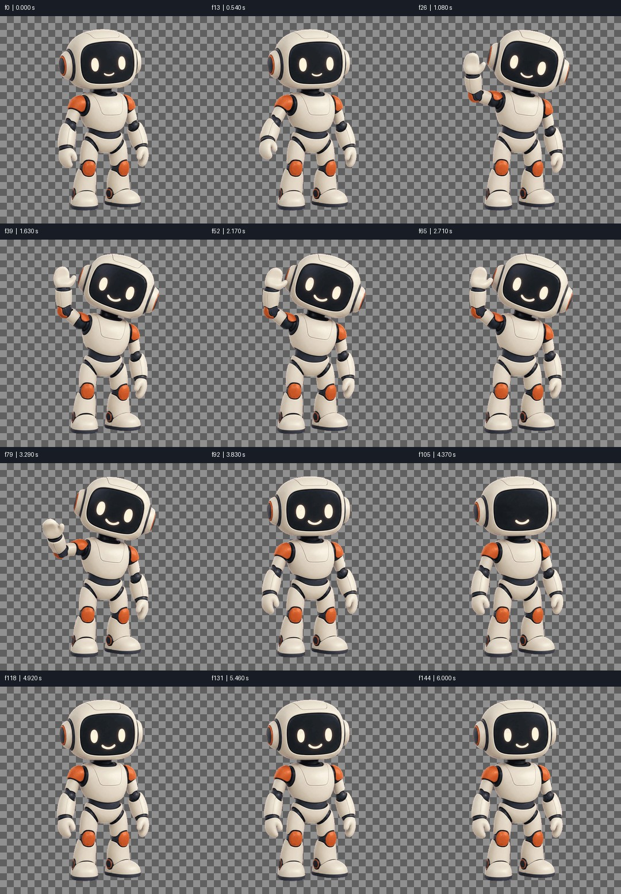
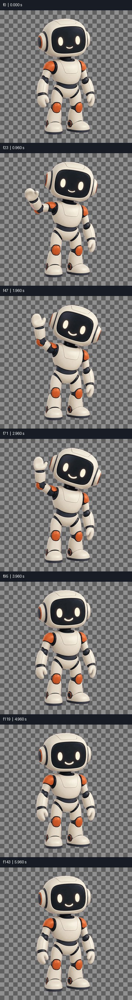
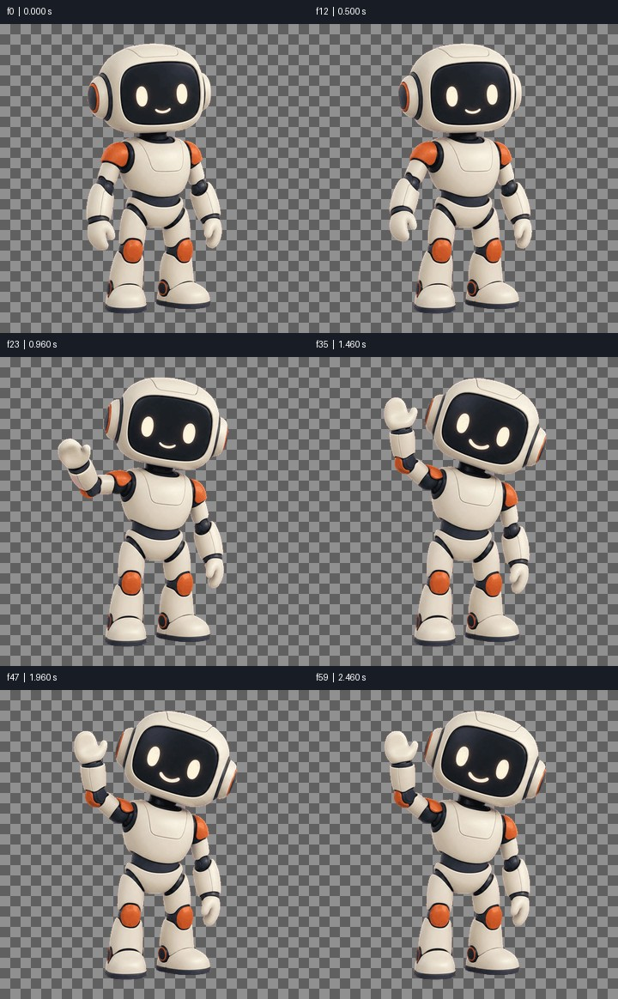

# Media QA: FAIL

final.gif | 145 frames | 6.040 s

Numeric screening is not proof of natural motion, correct semantics, good matting or audio/video sync. Review playback independently.

## PASS — frame0

Visible composition has exposure and contrast
- f0 / 0.000 s

```json
{
  "mean": 149.34848022460938,
  "contrast": 74.48033142089844
}
```

## PASS — flashes

Single-frame flash scan

## PASS — pops

Small transient pop scan; inspect in context

## PASS — freeze

Frozen stretches; mark intended pauses with --holds START-END or timeline still segments

```json
{
  "designed_holds": []
}
```

## PASS — cuts

Detected cut candidates (no hard cuts required)

```json
{
  "detected": [],
  "expected_seconds": []
}
```

## PASS — timeline_joins

Continuation/edit boundaries are not required hard cuts; review continuity

## FAIL — loop

Loop position and speed
- f144 / 6.040 s -> f0

```json
{
  "seam": 3.191627025604248,
  "median_step": 0.5722683966159821,
  "seam_ratio": 5.5771505896139395,
  "speed_ratio": 0.1402603385267301,
  "position_pass": false,
  "speed_pass": true,
  "speed_applicable": false
}
```

## N/A — loudness

N/A: no audio track

```json
{
  "applicable": false
}
```

## N/A — true_peak

N/A: no audio track

```json
{
  "applicable": false
}
```

## N/A — loudest_100ms

N/A: no audio track

```json
{
  "applicable": false
}
```

## N/A — silence

N/A: no audio track

```json
{
  "applicable": false
}
```





Analysis and sheets: 1.907 s.
