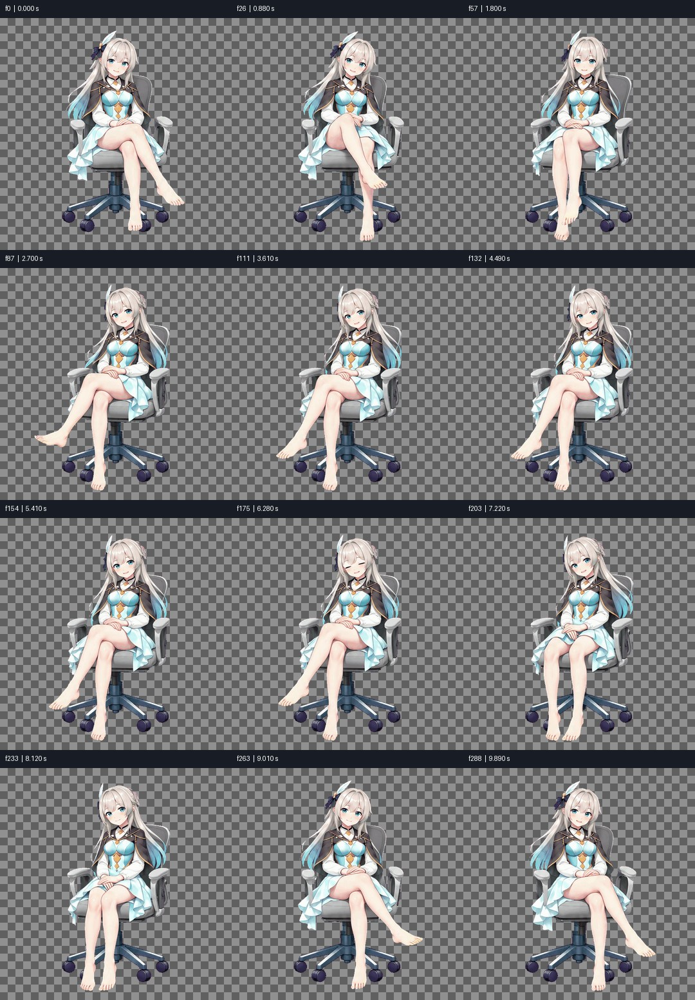
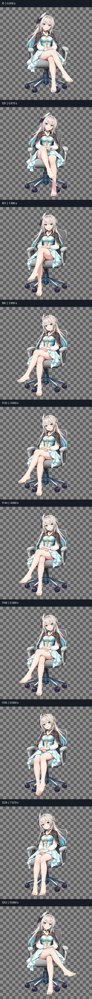
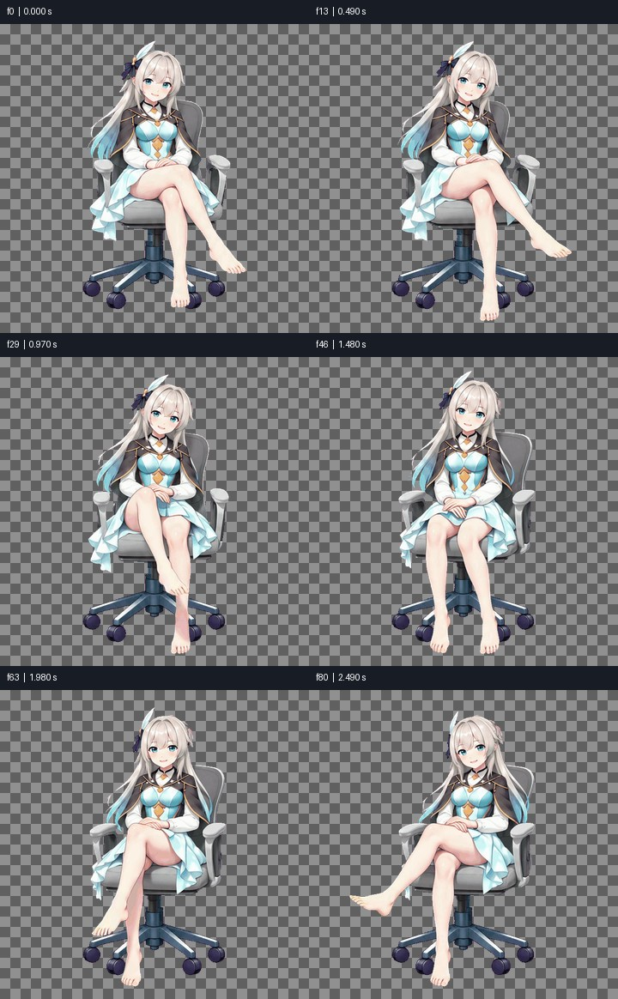

# Media QA: FAIL

final.gif | 289 frames | 9.930 s

Numeric screening is not proof of natural motion, correct semantics, good matting or audio/video sync. Review playback independently.

## PASS — frame0

Visible composition has exposure and contrast
- f0 / 0.000 s

```json
{
  "mean": 169.9418182373047,
  "contrast": 68.15204620361328
}
```

## PASS — flashes

Single-frame flash scan

## PASS — pops

Small transient pop scan; inspect in context

## WARN — freeze

Frozen stretches; mark intended pauses with --holds START-END or timeline still segments
- f140 / 4.820 s to f171 / 6.110 s (end exclusive)

```json
{
  "designed_holds": []
}
```

## PASS — cuts

Detected cut candidates (no hard cuts required)

```json
{
  "detected": [],
  "expected_seconds": []
}
```

## PASS — timeline_joins

Continuation/edit boundaries are not required hard cuts; review continuity

## FAIL — loop

Loop position and speed: speed mismatch
- f288 / 9.930 s -> f0

```json
{
  "seam": 7.129791259765625,
  "median_step": 1.1762319803237915,
  "seam_ratio": 6.061551954915344,
  "speed_ratio": 0.48088058189260735,
  "position_pass": false,
  "speed_pass": false,
  "speed_applicable": true
}
```

## PASS — loudness

N/A: no audio track

## PASS — true_peak

N/A: no audio track

## PASS — loudest_100ms

N/A: no audio track

## PASS — silence

N/A: no audio track





Analysis and sheets: 4.793 s.
