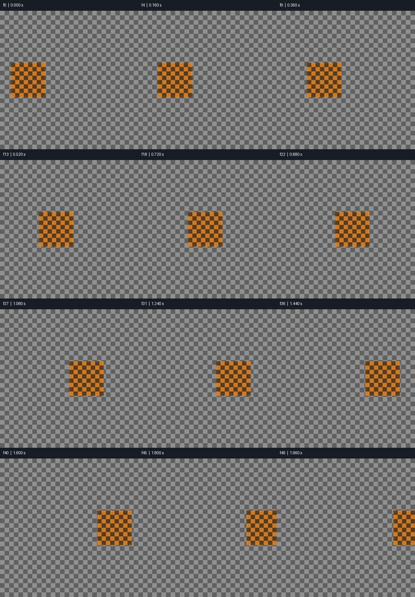
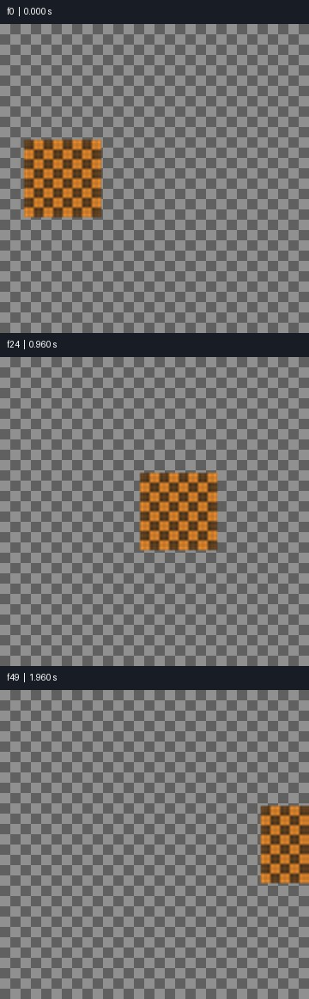
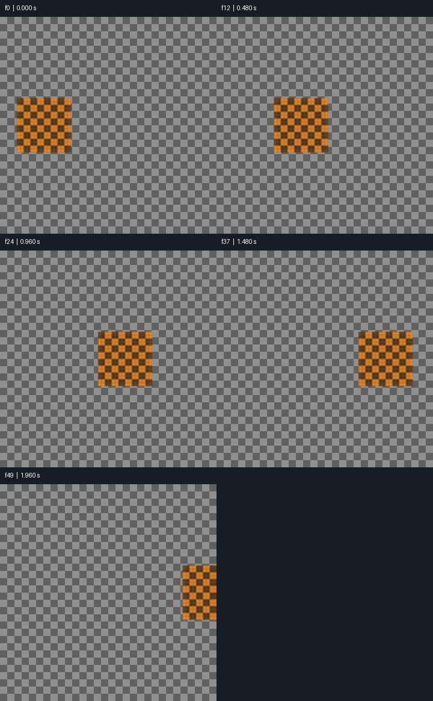

# Media QA: PASS

T | 50 frames | 2.000 s

Numeric screening is not proof of natural motion, correct semantics, good matting or audio/video sync. Review playback independently.

## PASS — frame0

Visible composition has exposure and contrast
- f0 / 0.000 s

```json
{
  "mean": 100.17500305175781,
  "contrast": 34.625
}
```

## PASS — flashes

Single-frame flash scan

## PASS — pops

Small transient pop scan; inspect in context

## PASS — freeze

Frozen stretches; mark intended pauses with --holds START-END or timeline still segments

```json
{
  "designed_holds": []
}
```

## PASS — cuts

Detected cut candidates (no hard cuts required)

```json
{
  "detected": [],
  "expected_seconds": []
}
```

## PASS — timeline_joins

Continuation/edit boundaries are not required hard cuts; review continuity

## PASS — loop

N/A: no loop requested

## PASS — loudness

N/A: no audio track

## PASS — true_peak

N/A: no audio track

## PASS — loudest_100ms

N/A: no audio track

## PASS — silence

N/A: no audio track





Analysis and sheets: 0.359 s.
