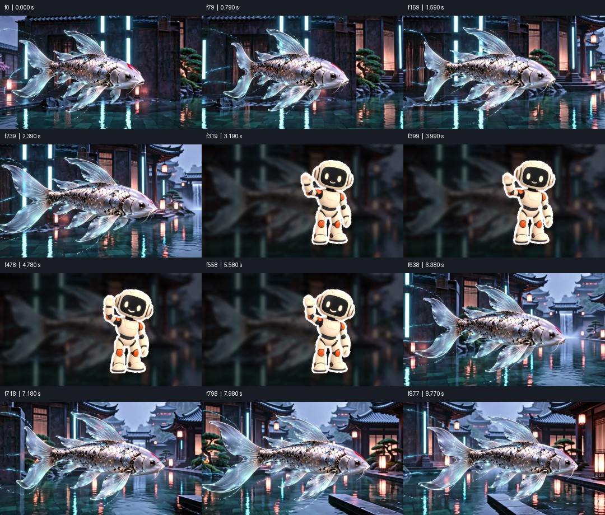
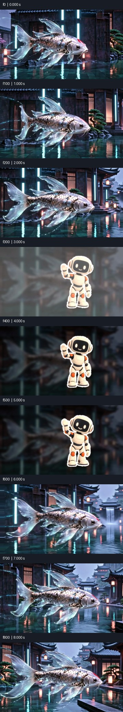
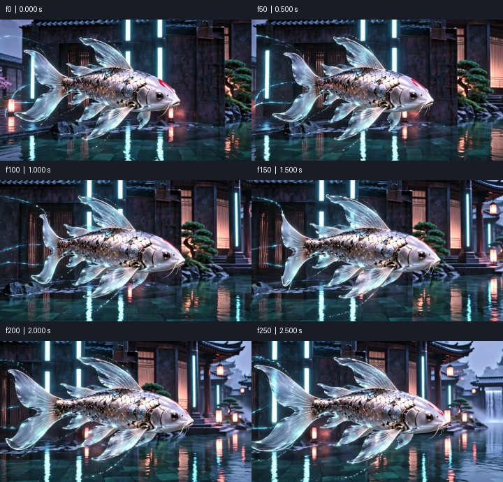

# Media QA: PASS

demo-b.mp4 | 878 frames | 8.780 s

Numeric screening is not proof of natural motion, correct semantics, good matting or audio/video sync. Review playback independently.

## PASS — frame0

Visible composition has exposure and contrast
- f0 / 0.000 s

```json
{
  "mean": 73.41438293457031,
  "contrast": 58.07067108154297
}
```

## PASS — flashes

Single-frame flash scan

## PASS — pops

Small transient pop scan; inspect in context

## PASS — freeze

Frozen stretches; mark intended pauses with --holds START-END or timeline still segments

```json
{
  "designed_holds": [
    {
      "frame": 316,
      "seconds": 3.16,
      "end_frame": 439,
      "end_seconds": 4.39
    },
    {
      "frame": 316,
      "seconds": 3.16,
      "end_frame": 439,
      "end_seconds": 4.39
    }
  ]
}
```

## PASS — cuts

Detected cut candidates (no hard cuts required)

```json
{
  "detected": [
    {
      "frame": 304,
      "seconds": 3.04
    },
    {
      "frame": 585,
      "seconds": 5.85
    }
  ],
  "expected_seconds": []
}
```

## PASS — timeline_joins

Continuation/edit boundaries are not required hard cuts; review continuity
- f293 / 2.930 s
- f439 / 4.390 s
- f585 / 5.850 s

## PASS — loop

N/A: no loop requested

## PASS — loudness

Integrated loudness: target -14 LUFS +/-1
- f0 / 0.000 s to f877 / 8.780 s (time end exclusive)

```json
{
  "lufs": -14.3
}
```

## PASS — true_peak

True peak ceiling -1 dBTP
- f0 / 0.000 s to f877 / 8.780 s (time end exclusive)

```json
{
  "dbtp": -3.1
}
```

## PASS — loudest_100ms

Loudest 100 ms RMS window (50 ms hop)
- f475 / 4.750 s to f485 / 4.850 s (time end exclusive)

```json
{
  "dbfs": -10.1708212931927
}
```

## PASS — silence

Silence >=0.4 s; inspect whether intended

```json
{
  "threshold_dbfs": -40
}
```





Analysis and sheets: 4.193 s.
