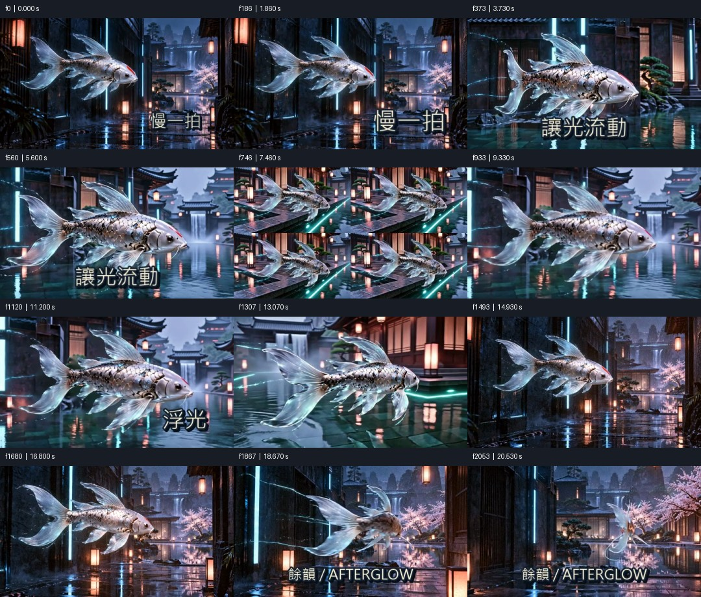
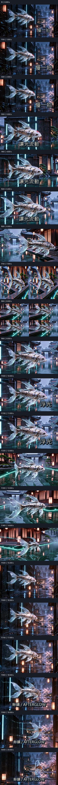
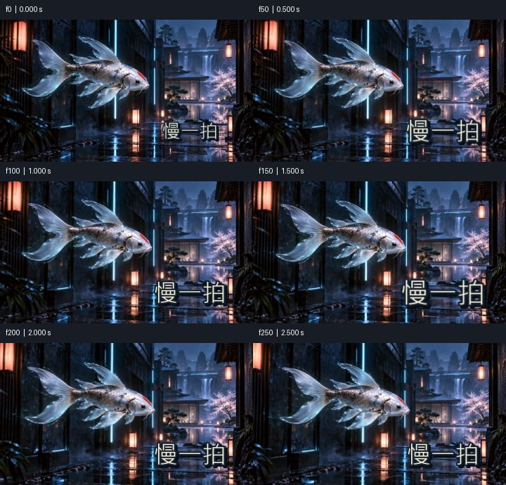

# Media QA: PASS

demo.mp4 | 2054 frames | 20.540 s

Numeric screening is not proof of natural motion, correct semantics, good matting or audio/video sync. Review playback independently.

## PASS — frame0

Visible composition has exposure and contrast
- f0 / 0.000 s

```json
{
  "mean": 53.26511764526367,
  "contrast": 48.75992965698242
}
```

## PASS — flashes

Single-frame flash scan

## PASS — pops

Small transient pop scan; inspect in context

## PASS — freeze

Frozen stretches; mark intended pauses with --holds START-END or timeline still segments

```json
{
  "designed_holds": []
}
```

## PASS — cuts

Detected cut candidates (no hard cuts required)

```json
{
  "detected": [
    {
      "frame": 292,
      "seconds": 2.92
    },
    {
      "frame": 586,
      "seconds": 5.86
    },
    {
      "frame": 896,
      "seconds": 8.96
    },
    {
      "frame": 900,
      "seconds": 9.0
    },
    {
      "frame": 1172,
      "seconds": 11.72
    },
    {
      "frame": 1176,
      "seconds": 11.76
    },
    {
      "frame": 1576,
      "seconds": 15.76
    }
  ],
  "expected_seconds": []
}
```

## PASS — timeline_joins

Continuation/edit boundaries are not required hard cuts; review continuity
- f292 / 2.920 s
- f586 / 5.860 s
- f880 / 8.800 s
- f1172 / 11.720 s
- f1466 / 14.660 s

## PASS — loop

N/A: no loop requested

## PASS — loudness

Integrated loudness: target -14 LUFS +/-1
- f0 / 0.000 s to f2053 / 20.540 s (time end exclusive)

```json
{
  "lufs": -14.3
}
```

## PASS — true_peak

True peak ceiling -1 dBTP
- f0 / 0.000 s to f2053 / 20.540 s (time end exclusive)

```json
{
  "dbtp": -2.3
}
```

## PASS — loudest_100ms

Loudest 100 ms RMS window (50 ms hop)
- f240 / 2.400 s to f250 / 2.500 s (time end exclusive)

```json
{
  "dbfs": -9.881655363233154
}
```

## PASS — silence

Silence >=0.4 s; inspect whether intended

```json
{
  "threshold_dbfs": -40
}
```





Analysis and sheets: 7.308 s.
